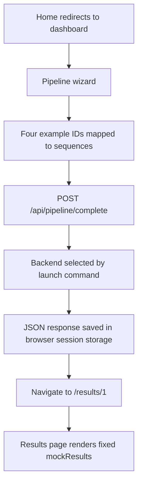

**BioScribe — Phase 1 ingestion and structural teardown**

Audit date: 14 October 2026. Scope: the current working tree, including pre-existing modified and untracked source files. This is an architectural inventory and execution baseline, not a scientific validation certificate or the ranked Phase 2 diagnostic. No application code, dependency installation, or configuration was changed during this audit.

**The repository contains a broad drug-discovery prototype undergoing a partial migration to a smaller computation backend.** Its documentation describes a unified platform for protein analysis, candidate generation, screening, explainability, clinical safety, and research collaboration. The inspected code supports some concrete calculations, but the paths exposed by the UI, launch scripts, and tests do not consistently select the same implementation. “Production ready,” “real,” “genuine,” and “AI” labels are not treated as evidence of capability.

The primary objectives are to accept a protein target, characterize its sequence, propose small molecules, prioritize candidates, and present/export results for researchers. Secondary product areas include imported screening campaigns, ADMET, literature, target discovery, patient stratification, RNA/CRISPR design, and educational simulations. The README explicitly describes research-only use and required experimental validation; those are the documented domain boundaries. See [README](E:/Bioscribe/CascadeProjects/windsurf-project/README.md:1) and [project vision](E:/Bioscribe/CascadeProjects/windsurf-project/PROJECT_CONTEXT_MASTER.md:1).

**Repository inventory.** All 73 backend Python files were parsed as Python syntax, representing 31,141 source lines. The frontend contains 40 App Router pages and 96 TSX files under `src/components`, including UI primitives. There are ten separate FastAPI application definitions and two backend test modules containing 26 test functions. These counts describe source inventory, not ten deployed services or 26 passing tests. Core entry points and dependencies were traced; every line of every ancillary feature was not reviewed.

| Layer | Implementation found | Operational significance |
| --- | --- | --- |
| Web application | Next.js 15.5.4, React 19.1.0, TypeScript, Tailwind 4, Radix components, Framer Motion | Browser pages call the backend directly; some calls use an environment URL and others hard-code localhost. |
| Molecular visualization | 3Dmol.js, Three.js/React Three Fiber, NGL | Includes browser retrieval of public PDB structures; displayed structures are not evidence of computed ligand poses. |
| HTTP backend | FastAPI/Uvicorn/Pydantic, multiple independent applications | Endpoint names, request fields, response envelopes, and capabilities vary by entry point. |
| New computation path | BioPython, RDKit, NumPy; four modules under `backend/engines` | Sequence properties, molecule enumeration/descriptors, heuristic affinity scoring, and empirical/rule-based ADMET. |
| Older model/service paths | Optional PyTorch/Transformers, local heuristics, random values and demo fallbacks | Capability depends on the selected backend, available packages, and fallback branch. |
| Storage | MongoDB adapter; process-local dictionaries; browser session storage | The new pipeline does not persist its results server-side. Storage components exist elsewhere but are not one connected persistence layer. |
| Deployment | PowerShell scripts, Dockerfile, Compose with MongoDB and Redis | The default container and standard backend script select the older backend. Redis is configured but no Redis client usage was found in backend Python source. |

Package versions above are from the [frontend manifest](E:/Bioscribe/CascadeProjects/windsurf-project/bioscribe-ai/package.json:1). Backend requirement files specify multiple different dependency sets; the locally installed environment is not identical to all of them.

**Which backend runs is a decisive part of the architecture.**

| Invocation or consumer | Selected implementation | Observed behavior |
| --- | --- | --- |
| Standard PowerShell launcher and Docker image | `main_real.py` | Hand-written sequence/property calculations, template molecules, randomized affinity variation, report dictionaries. |
| Enterprise PowerShell launcher | `main_enterprise.py` | Enterprise demonstrations plus AtomNet import, benchmarking, and compliance routers. |
| Python startup helper | `main.py` | Legacy protein/session workflow, MongoDB adapter, in-process background docking, AI and enterprise routes. |
| Updated shared frontend API client | Contract matching `api_genuine.py` | Expects structured nested BioPython/RDKit results, affinity scoring and ADMET routes. This client does not determine which backend the launch script starts. |
| Other standalone applications | `main_demo.py`, `main_perfect.py`, `api_unified.py`, `api_enhanced.py`, `api_advanced.py`, `api_v4_frontier.py` | Additional variants with differing route sets; not automatically composed into the default application. |

Evidence: [standard launcher](E:/Bioscribe/CascadeProjects/windsurf-project/start-backend.ps1:27), [Docker command](E:/Bioscribe/CascadeProjects/windsurf-project/Dockerfile:58), [enterprise launcher](E:/Bioscribe/CascadeProjects/windsurf-project/start-backend-enterprise.ps1:46), [Python launcher](E:/Bioscribe/CascadeProjects/windsurf-project/backend/start.py:40), [shared API client](E:/Bioscribe/CascadeProjects/windsurf-project/bioscribe-ai/src/lib/api.ts:1).

**The main browser journey has a disconnected results stage.** The home page redirects to the dashboard. Its discovery button opens the pipeline wizard. The wizard resolves one of four hard-coded PDB example identifiers to a sequence, posts it to `/api/pipeline/complete`, writes the response into `sessionStorage`, and navigates to `/results/1`. The results page does not read that stored response or retrieve a run by ID; it supplies a fixed `mockResults` object to `ExecutiveResults`. The wizard's submitted request also does not carry uploaded file contents or its ADMET/retrosynthesis options.

Evidence: [wizard request and storage](E:/Bioscribe/CascadeProjects/windsurf-project/bioscribe-ai/src/app/pipeline/new/page.tsx:68), [fixed results object](E:/Bioscribe/CascadeProjects/windsurf-project/bioscribe-ai/src/app/results/[id]/page.tsx:16), [rendered result source](E:/Bioscribe/CascadeProjects/windsurf-project/bioscribe-ai/src/app/results/[id]/page.tsx:138).

**The newer computation pipeline is separable and inspectable.** Its orchestration is in [api_genuine.py](E:/Bioscribe/CascadeProjects/windsurf-project/backend/api_genuine.py:291):

1. A Pydantic request supplies sequence, name, organism, and candidate count. Candidate count is bounded from 5 to 50; the sequence has a minimum length but no maximum in these request models.
2. `ProteinEngine` strips an initial FASTA header, normalizes whitespace, rejects unsupported residues, and computes BioPython sequence properties. It also produces propensity-based secondary structure, motif matches, disorder/PTM heuristics, and a druggability score.
3. `MoleculeEngine` decorates curated scaffolds, links/merges fragments, sanitizes structures with RDKit, deduplicates canonical SMILES, applies filters, and initially ranks by QED. These are algorithmic chemical transformations, not evidence that a trained generative model was invoked.
4. `AffinityScorer` combines molecular descriptors and aggregate sequence features using fixed weights, sorts candidates, and adds a confidence formula and proposed interaction categories. It explicitly does not calculate 3D docking poses. Its calibrated predictive accuracy is not established by the inspected code.
5. `ADMETPredictor` appends empirical equations and structural-rule estimates, including toxicity flags and heuristic excretion estimates.
6. The API returns candidates, summaries, method labels, disclaimers, timestamps, and a timestamp-derived pipeline ID. It has no connected durable job record, result store, or worker queue. Computation runs inside the request; `async def` does not itself offload the synchronous scientific work.

Engine evidence: [sequence processing](E:/Bioscribe/CascadeProjects/windsurf-project/backend/engines/protein_engine.py:77), [candidate generation](E:/Bioscribe/CascadeProjects/windsurf-project/backend/engines/molecule_engine.py:127), [affinity formula](E:/Bioscribe/CascadeProjects/windsurf-project/backend/engines/docking_engine.py:105), [confidence formula](E:/Bioscribe/CascadeProjects/windsurf-project/backend/engines/docking_engine.py:179), [ADMET](E:/Bioscribe/CascadeProjects/windsurf-project/backend/engines/admet_engine.py:32).

“Deterministic” must be evaluated at the scientific payload level: this pipeline returns wall-clock timestamps, elapsed time, and timestamp-derived IDs. Repeated complete responses cannot be byte-identical. More importantly, reproducibility of a formula does not establish its predictive validity.

**Data ingestion and external dependencies are distributed across different applications.**

| Input/dependency | Located implementation | Connection and limits observed |
| --- | --- | --- |
| Raw sequence / single FASTA input | New protein engine and older sequence modules | Parsing rules vary; there is no unified canonical input contract across applications. |
| SMILES | New molecule validation and ADMET routes | RDKit parsing/calculation is implemented; input batches have no explicit length bound in the new request schema. |
| Screening CSV/JSON | AtomNet upload service and router | Column mappings for AtomNet, GNINA, Vina and generic formats; imported projects are held in dictionaries in the enterprise application. |
| UniProt, AlphaFold DB, RCSB PDB, ChEMBL | `real_data_services.py` | Actual HTTP client code exists, wired through `main_demo.py`; successful live integration was not verified during this audit. |
| Hugging Face ESM-2 | Legacy `ai_molecular_engine.py` | Can load local weights or use remote inference; local tokenization truncates at 512 tokens; fallback returns random embeddings. |
| Literature / PubMed | `LiteratureExplorer.tsx` | Hard-coded example publications and a timed search animation; no live PubMed retrieval was found in this path. |
| Clinical safety | DDI, PGx, adverse-event, evidence and signal components | Inspected screens contain local example datasets/rules. Their existence does not establish live clinical reference integration. |

Evidence: [CSV/JSON ingestion](E:/Bioscribe/CascadeProjects/windsurf-project/backend/services/file_upload_service.py:1), [external data clients](E:/Bioscribe/CascadeProjects/windsurf-project/backend/services/real_data_services.py:16), [demo application's search route](E:/Bioscribe/CascadeProjects/windsurf-project/backend/main_demo.py:421), [ESM truncation and fallback](E:/Bioscribe/CascadeProjects/windsurf-project/backend/models/ai_molecular_engine.py:116), [literature examples](E:/Bioscribe/CascadeProjects/windsurf-project/bioscribe-ai/src/components/LiteratureExplorer.tsx:56), [DDI examples](E:/Bioscribe/CascadeProjects/windsurf-project/bioscribe-ai/src/components/DrugInteractionChecker.tsx:75).

The core pipeline is sequence/chemistry processing. I found no connected document ETL, clinical-note entity extraction, vector index, retrieval-augmented generation, or citation-verification pipeline in the traced paths. For this repository, the observed context-loss issue is legacy protein-token truncation; a deployed semantic-search quality problem has not yet been established.

**Screening, reporting, and persistence need distinct capability labels.** The enterprise application's AtomNet layer supports importing and displaying external results, demo data, XAI/FAIR metadata, and reports. Its projects and derived caches are process-local dictionaries. The inspected Vina and GNINA wrappers return mock scores even on the branch where their executables are present. The benchmark service has correlation/RMSE calculation code, but generates enrichment metrics randomly and also fabricates correlation/error metrics when too few matched labels exist. Its embedded example affinities are not an audited ground-truth dataset.

Evidence: [AtomNet storage](E:/Bioscribe/CascadeProjects/windsurf-project/backend/routers/atomnet_router.py:42), [Vina implementation](E:/Bioscribe/CascadeProjects/windsurf-project/backend/services/screening_engines.py:218), [GNINA implementation](E:/Bioscribe/CascadeProjects/windsurf-project/backend/services/screening_engines.py:286), [benchmark behavior](E:/Bioscribe/CascadeProjects/windsurf-project/backend/services/benchmark_service.py:105).

The older `main.py` creates a MongoDB manager whose default is memory storage; no startup connection call is wired into that application. The default `main_real.py` does not use this manager, and the new pipeline does not import it. Report generation and export routes exist in older applications, but are not a single export layer for the new result schema. See [legacy initialization](E:/Bioscribe/CascadeProjects/windsurf-project/backend/main.py:47), [storage default](E:/Bioscribe/CascadeProjects/windsurf-project/backend/database/mongodb.py:39), and [legacy exports](E:/Bioscribe/CascadeProjects/windsurf-project/backend/main.py:278).

**Immediate architectural risks are recorded here without Phase 2 ranking.**

- Scientific provenance is inconsistent: computed descriptors, hand-set formulas, random values, and fixed demonstrations can all reach research-style outputs. For example, the standard backend adds random affinity variation while reporting `mock_data: False` and describing docking completion.
- The frontend/backend migration is incomplete: callers, launch scripts, result rendering, and tests target different contracts. A successful HTTP response therefore does not establish that the displayed scientific result came from the requested run.
- Persistence and execution are not durable across the inspected main paths: request-local computation, browser storage, process-local caches, and in-process background tasks do not provide restart recovery or a shared job state across workers. Ancillary concurrency helpers do exist, but no durable queue was found for the core pipeline.
- Access control and privacy controls are not established by the inspected API wiring: no authentication/authorization dependencies were found protecting the inspected routes; some apps allow wildcard CORS; Compose contains default database credentials; the new pipeline error response can include a traceback. Remote inference paths can transmit sequence data. Configuration flags and compliance-themed modules are not proof that these controls are enforced.
- The evidence layer cannot currently substantiate scientific accuracy: hard-coded literature, simulated engine outputs, and partially randomized benchmarks cannot independently verify candidate activity or safety. Published formula labels still need implementation and applicability checks in later phases.

Supporting examples: [random affinity](E:/Bioscribe/CascadeProjects/windsurf-project/backend/main_real.py:421), [reported docking summary](E:/Bioscribe/CascadeProjects/windsurf-project/backend/main_real.py:620), [new API errors](E:/Bioscribe/CascadeProjects/windsurf-project/backend/api_genuine.py:386), [deployment configuration](E:/Bioscribe/CascadeProjects/windsurf-project/docker-compose.yml:10). No external medical or regulatory claims were independently validated in Phase 1.

**Execution baseline from this audit.**

| Check | Observed result | What it establishes |
| --- | --- | --- |
| AST parsing of 73 backend Python files | Passed; no syntax errors | Syntax only, not imports, runtime correctness, or science. |
| Root `.venv` interpreter | Failed; refers to an unavailable Python executable | This virtual environment is not usable as inspected. |
| `backend/venv` interpreter | Python 3.11.9 works | A separate usable interpreter exists. |
| New API import using `backend/venv` | `ModuleNotFoundError: No module named 'rdkit'`; module lookup also returned absent | The new pipeline cannot start in that environment as inspected. No dependency was installed. |
| Vina/GNINA executable lookup | Neither found on the inspected process PATH | Does not prove absence from every other location. |
| TypeScript `tsc --noEmit --incremental false --pretty false` | Compiler exit code 2; eight syntax diagnostics in `ScientificMolecularViewer.tsx`, beginning at line 149 | Frontend type checking is blocked; later type errors may be masked. |
| Existing backend pytest modules | Collected 26 tests, stalled before the first completed test, then interrupted | No passing or failing test result is claimed; cause remains undiagnosed. |

The attempted test command was `venv\Scripts\python.exe -B -m pytest tests/test_api.py tests/test_atomnet.py -q -p no:cacheprovider --tb=short`, from the backend directory. The test modules target [main_real](E:/Bioscribe/CascadeProjects/windsurf-project/backend/tests/test_api.py:14) and [main_enterprise](E:/Bioscribe/CascadeProjects/windsurf-project/backend/tests/test_atomnet.py:14); they do not test the new `api_genuine` pipeline. The compiler's first error is at [ScientificMolecularViewer.tsx:149](E:/Bioscribe/CascadeProjects/windsurf-project/bioscribe-ai/src/components/ScientificMolecularViewer.tsx:149).

No services were deployed, external scientific APIs queried, model weights downloaded, experimental results verified, or load/security benchmarks completed. Pre-existing source changes were preserved. The empty requirements specification, multiple architecture narratives, and standalone experimental text files are not a reconciled executable specification.

**Phase 1 is complete.** The resulting scope for the next phase is a protein-sequence and small-molecule research workflow, with a separate imported-screening capability and explicitly differentiated demonstration features. Selecting the authoritative backend, defining the evidence required for each output, and ranking the implementation failures belong to Phase 2. Refactoring and a new validation framework remain gated by the user's requested phase transitions.
