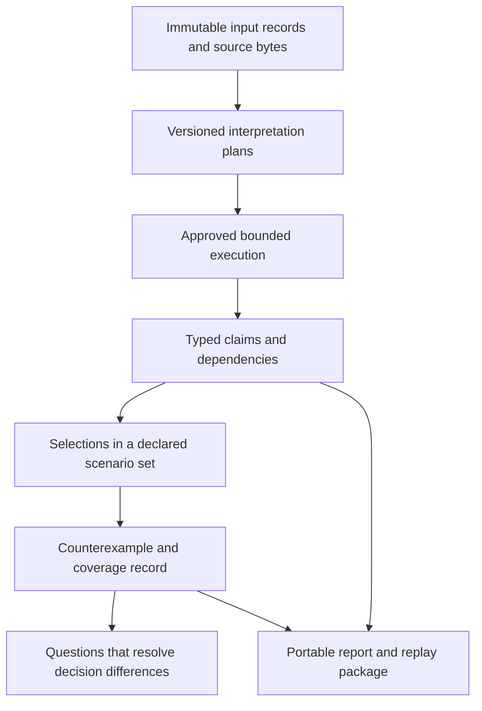

# BioScribe: project audit and research development roadmap

Date: 24 October 2026. Status: architecture/research proposal, not implemented capability or scientific qualification.

The strongest direction is **a molecular analysis system that explains what would change its conclusions, supplies a reproducible counterexample when a decision is fragile, and identifies the missing evidence needed to resolve that fragility**.

This extends the current evidence and replay foundations. It does not require inventing an affinity predictor, claiming clinical usefulness, or accessing the blocked ALDH1A1 study.

## Scope and evidence

This review inventoried 318 source files across the backend, current frontend, archived frontend, client checks, Phase 4 preflight, educational exercises and hackathon tooling. The inventory contains 83,836 lines, much of it inherited or inactive. That is a census, not a claim that every line received an exhaustive security or scientific review. See [source inventory](source-inventory.json) and [inventory script](inventory.py).

Detailed inspection concentrated on the supported API composition, scientific computation, molecular parsing, authoritative schemas, persistence and replay, worker bounds, authentication/checkpoint boundaries, frontend validation, comparison/challenge logic, example conformers, dependency/runtime packaging and the validation-framework boundary. Legacy entry points, route quarantine, old product plans and test organisation were sampled to distinguish active capabilities from historical ambitions.

Two new bounded probes reproduced a representation-sensitive tied selection and backend reconstruction of omitted constant evidence metadata. A same-runtime exact repeat also passed. See [executable probes](probe.py) and [results](probe-results.json). No application source was changed. No study outcomes, confidential data or patient data were accessed. Existing test counts were treated as historical records; the full application suites, browser, clean install and cross-machine checks were not rerun for this audit.

The first inventory attempt traversed an installed environment and was interrupted without a completed inventory. The corrected inventory prunes environments and runtime data. Only its completed source-only result is reported.

## What the project actually contains

| Area | Current role | Implication for further work |
| --- | --- | --- |
| `backend/bioscribe` | Supported v3 API, biological input policies, descriptors, evidence records, jobs, authentication and checkpoint protocol | Retain historical contract semantics; do not relabel old evidence when adding features. |
| `backend/provenance_lab` | Supported HM-01 molecular engine, typed diagnostics, graph identity, frozen references and offline replay | Best foundation for the next product. Seven Python files, 677 lines in this inventory. |
| `bioscribe-ai/src/lib/phase3` and `Phase3*.tsx` | Current workbench, explorer, evidence viewer, import validation, comparisons and challenges | Add a focused decision workflow here rather than reviving disabled menus. |
| `learning` | Synthetic-label replay and standalone teaching viewer | Useful sandbox; invented labels must remain separate from empirical evidence. |
| `validation/phase4` | Protocol and declared split/file preflight | Does not adjudicate labels, establish actual independence or calculate predictive qualification. |
| `validation/studies/BS-RANK-001` | Blocked scientific study design | Outside this development programme unless its separate gates are fulfilled. |
| Older engines, services, models and `legacy-ui` | Historical speculative features | Seventeen source files contain explicit legacy entry guards. Presence in the repository is not availability. |
| Docker, locks, launchers and verification records | Local public-data execution and recorded portability evidence | Useful base, with material release, distribution and independent-reproduction gaps. |

The original roadmap spans generation, docking, ADMET, literature, enterprise and clinical ideas. Those ambitions exceed the supported evidence. A narrow product with unusually strong reasoning about molecular evidence has a clearer technical identity than activating all those modules.

## Findings and acceptance criteria

Priorities below are development priorities, not claims of an exploitable security incident. **A** means resolve before extending the corresponding contract; **B** means important product/architecture gap; **C** means deployment or long-term research gate. Some are intentional limitations rather than defects.

### G1 — A: reproducible ranking can still depend on spelling

**Evidence:** `backend/provenance_lab/engine.py:170–179` breaks score ties using original-input SHA-256, then row index. `lab-challenges.ts` explicitly excludes selection invariance from the equivalent-spelling challenge. The new probe found:

| | Input 1 | Input 2 | Budget-one selection |
| --- | --- | --- | --- |
| Before | `C[C@H](O)C(=O)O` | `C[C@@H](O)C(=O)O` | Input 1 |
| After | `C([C@H](C)O)(=O)O` | unchanged | Input 2 |

The identity of each graph and all property records stayed unchanged. Both descriptor distances were `0.97556762`. This is not a wrong descriptor calculation or a violation of the documented current tie-break. It is a decision sensitivity that a student can easily misunderstand. Equal two-dimensional descriptors also do not establish equal biological behaviour of stereoisomers.

**Required evolution:** version the selection policy. Distinguish a deterministic operational choice from evidence of superiority. Show tied alternatives at the selection boundary. Consider canonical-identity ordering for the operational tie-break while preserving the original package/runtime.

**Acceptance:** fixed graph sets and scores yield the same selected identities under spelling and row-order changes under the new policy; exact budget is retained; ties remain visible; old packages reproduce with their old policy. The current probe becomes an explicit regression fixture, not a silently edited historical result.

### G2 — A: incoming evidence completeness differs between backend and browser

**Evidence:** `schemas.py:54–58` supplies constant defaults for method/fidelity/validation fields. `lab.ts:14–26` makes every declared output field required at browser import. Removing `method`, `implementation_fidelity`, `validation_record` and `predictive_validation` from every property lets backend `verify()` reconstruct the original package and complete a fresh matching replay. The browser's original-document schema requires them.

**Consequence:** different entry points disagree about whether a document explicitly supplied its evidence metadata. This probe did not demonstrate fabricated numbers, predictive qualification or a checksum bypass: backend reconstruction produced the original constants and recomputation matched.

**Required evolution:** separate internal construction models from strict received-artifact models. If reconstruction is deliberately supported, emit an explicit repair record and original-byte hash; do not treat an incomplete received artifact as a complete original.

**Acceptance:** the same mutation corpus has matching API, CLI and browser acceptance decisions; omitted metadata is rejected or explicitly recorded as reconstructed; no field becomes scientifically validated by repair.

### G3 — B: identity is one declared relation, not a complete answer to “same molecule”

**Evidence:** `engine.py:18–23`, `parse()` and `Result.identity_policy` preserve charge, isotope, fragments, tautomer and stereochemistry. This is conservative and appropriate. There is only one active exact-isomeric-graph identity policy.

**Gap:** users cannot explore why a salt, parent, protomer or stereoisomer is related under one purpose but distinct under another. There is no versioned transformation branch or traceable choice of selection unit.

**Acceptance:** every alternate relation names its purpose, method, parameters, losses and original-to-derived mapping. No automatic parent merge. Unspecified stereochemistry is not treated as a confirmed stereoisomer. A graph relation is never presented as proof that two physical samples are identical.

### G4 — B: provenance records describe runs but not dependencies of conclusions

**Evidence:** fields carry evidence metadata and runs carry hashes, but there is no machine-readable graph saying which claim depends on which source assertion, transformation or comparison. `lab-diff.ts` reports changes and correctly avoids causal attribution.

**Gap:** removing one reference or changing one method cannot selectively mark affected conclusions stale. The same whole-engine/snapshot hash covers many dependencies, including dependencies irrelevant to a particular descriptor.

**Acceptance:** withdrawing a frozen reference invalidates its correspondence claim, while unchanged graph-derived calculations retain their correct status. Changing a calculation invalidates its downstream ranks. Historical exports stay immutable and receive a separate superseding evaluation.

### G5 — B: six challenges test a small, fixed neighbourhood

**Evidence:** `lab-challenges.ts` defines reorder, canonical spelling, duplicate, empty input, budget and forged-number perturbations. Each is valuable. They are not a search over adversarial chemical representations or a method for shrinking failures.

**Acceptance:** introduce a versioned generator and relation-specific eligibility predicates; preserve seeds, bounds, rejected transformations and complete coverage denominators. Save every failure witness. A stopped search says “incomplete”, not “robust”. Domain experts must justify chemical invariants; generated syntax alone is not an oracle.

### G6 — B: frozen reference and test diversity are narrow

**Evidence:** six actual identity records cover three compounds. The 24-case comparison is explicitly curated. The parser supports a bounded graph domain. No representative sampling argument establishes population-wide failure rates.

**Acceptance:** create a separate, openly licensed reference/challenge release with documented sampling strata, adjudicated expected relations, source-byte hashes, source release metadata when available, and held-out challenge cases. Include charged species, salts, isotopes, stereochemistry, alternative spellings and unsupported graphs. Report coverage by category rather than a single reassuring score. Do not use assay outcomes from the blocked study.

### G7 — B: historical replay needs trusted runtime distribution

**Evidence:** `engine.py:244–259` refuses an unavailable installed bundle. The lock pins package versions but not wheel hashes; the runtime check accepts Python 3.11 patch versions. The scientific hash excludes observed platform metadata. Recorded portability covers two OS environments on one physical host.

**Acceptance:** publish an approved runtime catalogue with immutable image/build digests, binary dependency hashes, source licence information and a supported-platform matrix. Independently replay known packages on a second machine. Keep exact declared-payload equality separate from toleranced cross-implementation comparison. Never execute source uploaded inside a package.

### G8 — B: evidence grows faster than the release workflow

**Evidence:** client verification spans multiple scripts, while `package.json` exposes only some as named test commands. No repository `.github` directory was present. Launcher's live preflight is useful but is not the full acceptance suite. `/v3`, `/lab` and the learning CLI deliberately have different contracts and tie policies.

**Acceptance:** one documented release command runs the relevant matrix, emits a manifest bound to source/dependency hashes, and distinguishes fresh from historical evidence. Cross-contract conversion must be explicit and must preserve policy history. Add a small independently authored fixture oracle so an implementation and its verifier are less likely to share the same mistaken assumption.

### G9 — B: recovery is durable, but workspace navigation is rudimentary

**Evidence:** jobs can be resumed by ID, but the supported route set does not expose an owner-scoped run-list endpoint. Multiple workflows spread experiments across pages and files. One global queue and serial worker favour a local demo, not a classroom workload.

**Acceptance:** owner-scoped experiment history, persistent library record IDs, lineage between runs, cancellation/recovery tests, and explicit capacity measurements before increasing limits. Keep original row identities across reordering and transformations.

### G10 — B: the 3D experience is an example library

**Evidence:** the current viewer consumes `conformers.json` and correctly displays “No matching conformer” for other identities. It does not generate conformers for arbitrary submitted molecules.

**Acceptance:** if expanded, use a bounded, versioned generation service with fixed seeds, explicit stereochemical policy, optimisation status and graph binding. Mark the conformer illustrative; do not imply experimental geometry, binding pose or one uniquely correct conformation. This is useful polish, not the flagship research contribution.

### G11 — C: integrity, authorship and custody remain different promises

**Evidence:** packages explicitly disclaim authenticated authorship. `bioscribe/checkpoints.py` requires an independently protected latest checkpoint and is not deployed as that boundary. Lab storage is a mutable local database, without independently witnessed audit history. Network monkey-patching is application containment, not an OS security boundary.

**Acceptance:** before broader deployment, demonstrate protected signing keys/checkpoints, freshness and rollback detection, retention/deletion behaviour, OS isolation, authorisation, backup restore and workload limits. Signed false results are still false results. Public transparency systems are not approved destinations for private scientific data by default.

### G12 — B/C: usefulness and predictive science are separate missing evidence

**Evidence:** no participant study is available. The Phase 4 code checks protocol declarations and correspondence; it does not establish empirical label truth or predictive performance. Active predictions remain unassessed.

**Acceptance:** assess student error detection and task completion with consenting participants when available. For any future predictive claim, separately establish a precisely defined endpoint, appropriate empirical data and independent validation. A good educational product can proceed without claiming to have completed that scientific programme. The user has declined participants for now, so user value remains untested.

## Prior art: what should not be claimed as a new invention

This is a focused landscape review, not a patent search or exhaustive proof of uniqueness. Sources were checked on 24 October 2026. Documentation for newer library versions is background, not evidence that the currently pinned release implements identical behaviour.

| Established foundation | Relevant primary source | Consequence for BioScribe |
| --- | --- | --- |
| Structure checks, standardisation and chemical-data diagnostics | [ChemAudit](https://github.com/Kohulan/ChemAudit), [ChEMBL Structure Pipeline](https://github.com/chembl/ChEMBL_Structure_Pipeline) | More validation widgets alone provide weak differentiation. |
| Identity schemes sensitive or insensitive to stereo/tautomers | [RDKit RegistrationHash](https://mail.rdkit.org/docs/source/rdkit.Chem.RegistrationHash.html) | Multiple identity hashes are an existing technique. |
| Standardisation affects structure-to-data mappings and descriptors | [Mansouri et al., QSAR-ready workflow, 2024](https://link.springer.com/article/10.1186/s13321-024-00814-3) | Preserve task context; a normalised representation is not universally correct. |
| Descriptor implementations affect compound ranking | [Sosnina et al., 2018](https://pubmed.ncbi.nlm.nih.gov/29689160/) | Ranking-sensitivity research already exists; our review used the abstract, not an independently reproduced study. |
| Results explored across defensible analysis choices | [Specification curve analysis](https://doi.org/10.1038/s41562-020-0912-z) | An assumptions explorer adapts an established approach. Scenario counts are not probabilities. |
| Provenance graphs and reproducible workflow packages | [W3C PROV](https://www.w3.org/TR/prov-overview/), [Workflow Run RO-Crate](https://www.researchobject.org/workflow-run-crate/profiles/), [AiiDA provenance](https://aiida.readthedocs.io/projects/aiida-core/en/stable/topics/provenance/concepts.html), [ReproZip](https://docs.reprozip.org/en/latest/) | Do not invent another opaque format when standards can expose the new reasoning layer. |
| Shrinking a failing input and targeted property testing | [Zeller's delta-debugging tutorial](https://www.st.cs.uni-saarland.de/dd/ddusage.php3), [Hypothesis](https://hypothesis.readthedocs.io/en/latest/settings.html) | Failure minimisation is established; chemical validity and explanation are the domain challenge. |
| Counterexample-guided refinement | [Clarke et al., CAV 2000 paper](https://web.stanford.edu/class/cs357/cegar.pdf) | Use the reasoning pattern, without claiming our finite scenario explorer is a formal model checker. |
| Identity-bound release signing and witnessed events | [Sigstore signing](https://docs.sigstore.dev/cosign/signing/overview/) | Use established cryptography for distribution. It does not validate chemistry. |
| Browser-side chemistry | [RDKit MinimalLib](https://github.com/rdkit/rdkit/blob/master/Code/MinimalLib/README.md) | Offline browser calculation is feasible in principle, but API coverage and parity need testing. It is not itself novel. |

The potential original contribution is the integration and evaluation of **decision sensitivity, chemical identity assumptions, minimal witnesses and evidence-resolution guidance** for students. That originality remains a hypothesis until implemented and compared with relevant systems.

## Inventive methods applied

1. **First-principles decomposition:** distinguish the supplied string, interpreted graph, physical sample, calculated property, selection rule and empirical claim. One hash cannot answer all six questions.
2. **Inversion:** ask what change would invalidate a result, rather than only how to produce another result.
3. **Contradiction resolution:** preserve originals and create explicit branches, allowing exploration without silent correction.
4. **Transfer from compilers:** encode admissible claim types and dependencies so unsupported conclusions cannot be constructed through the normal reporting path.
5. **Counterexample-guided refinement:** search for a concrete decision-changing example; use it to identify which unresolved assumption matters.
6. **Robust decision analysis:** compare selections across a finite, declared set of admissible interpretations without inventing probability distributions.
7. **Ablation:** require evidence that each added component helps beyond a simpler baseline. Complexity is not a measure of novelty.

These are working methods used in this proposal, not an assertion that famous researchers endorse it.

## Proposed development 1: Decision Stability Explorer

**User question:** “Would I still choose these molecules if I made another defensible interpretation of the inputs?”

**Interaction:** display a fixed-budget shortlist beside an assumptions panel. A student can explore spelling equivalence, tie treatment, explicit graph-versus-parent interpretation and approved method versions. Changing an assumption highlights which selections changed and presents the exact saved witness. Branching never overwrites the original experiment.

**Core model:** define a finite scenario set Ω before evaluating it. Every scenario contains a versioned identity/transformation policy, parameters, method/runtime, fixed selection budget and source links. A selection S(ω) is a set of stable library record IDs in the same selection universe. Compute:

- `always_selected = intersection of S(ω)`
- `possibly_selected = union of S(ω)`
- `conditional = possibly_selected minus always_selected`

These names are conditional on complete evaluation of the declared scenario set, not all conceivable chemistry. In partial exploration, label only “selected in all evaluated scenarios”; do not issue the stronger status. A single valid counterexample establishes instability, while absence of a counterexample in a bounded search does not establish stability.

**Critical design detail:** parent stripping or deduplication can change the candidate population. Selection units must remain explicit: input record, chemical graph, parent family or physical sample. Compare branches only after an adjudicated mapping to the same universe; otherwise return `not_comparable`. Never merge stereoisomers merely to get an attractive stability score.

**Acceptance:** reproduce the audit's spelling-sensitive tie witness; under a new versioned policy prove representation invariance over the fixture set; expose boundary ties; a stereo-only change that leaves a 2D descriptor unchanged must not create a fake effect; an incomplete scenario run cannot emit a complete certificate. Compare exact intersection/union with an independent exhaustive oracle on small fixtures.

**Novelty assessment:** strongest product direction; underlying sensitivity and possible-world reasoning are established. A useful scientific contribution would require evidence that this interface finds consequential errors or improves decisions beyond a standard comparison table.

## Proposed development 2: Minimal Counterexample Finder

**User question:** “What is the smallest concrete example that explains why this result is unstable or inconsistent?”

Extend Experiment Challenges with bounded generation of equivalent spellings, reordered libraries and schema mutations. When a specified relation fails, shrink the library and transformation sequence while preserving the same failure predicate. First reduce records, then policy changes; graph edits are a later, harder stage because they can destroy the chemistry or change the question.

Return the before/after request, both saved results, unchanged assumptions, differing selections, search trace and minimality scope. Distinguish a valid counterexample from an unrelated parse failure. Use `pass`, `fail` and `unresolved` during minimisation. “1-minimal under single-record deletion” is precise; “smallest possible” usually is not.

**Acceptance:** injected selection, duplicate-handling and metadata faults produce independently replayable witnesses; normal controls do not produce false failures; shrinking retains the original failure type; run/time exhaustion returns partial status. Fixed seeds and versioned generators reproduce the same candidate sequence. No untrusted uploaded code is executed.

**Build order:** first major feature after contract consistency. It builds directly on the six existing challenges and has a clear demonstration using the audit witness.

## Proposed development 3: Evidence Dependency Compiler

**User question:** “Which statements does this experiment actually support, and what stops being supported if evidence changes?”

Represent claims as typed nodes such as `GraphParsed`, `DescriptorCalculated`, `FrozenRecordCorrespondence`, `SelectionUnderPolicy`, `ReplayMatched` and, only in a separately qualified future system, `EndpointPrediction`. Each claim has required parent evidence, an applicable rule/version and a deterministic status evaluator. The reporter renders these typed claims; an LLM, if later used, can explain them but cannot authorise a new claim type.

A reference is withdrawn in a sandbox: the reference-correspondence node becomes unavailable, while calculation nodes independent of that reference remain computed. A method changes: derived numerical comparisons and selections become stale until recomputed. Preserve the previous record and create a new evaluation, rather than retroactively editing the evidence.

**Acceptance:** no rule allows `ReplayMatched` or a reviewer click to imply biological validity. Exhaustive small-graph tests establish correct dependency invalidation; unrelated facts remain unchanged; cycles and missing dependencies are rejected; UI and exports render the same status. Provide W3C PROV/RO-Crate mappings where appropriate.

**Differentiation:** an executable account of why a statement is permitted, rather than another graph showing that files are connected. This is a proposed application of established type systems and provenance ideas.

## Proposed development 4: Decision-Directed Clarification

**User question:** “What single missing fact should I check next to resolve this disagreement?”

After the Stability Explorer finds conflicting selections, list concrete unresolved facts: intended salt form, source stereochemistry, whether two records refer to the same sample, or which documented method definition applies. Candidate questions partition the admissible scenarios. Rank questions by the worst-case number of distinct remaining decision outcomes, with explicit user-supplied effort if desired.

Count distinct decisions, not raw branches: duplicating a synonymous scenario must not make a question look more useful. Do not call this expected information gain or expected experimental value without a justified probability/cost model. A software-suggested question is not evidence of its answer; the resolution requires a source reference or explicitly hypothetical user choice.

**Acceptance:** a known fixture's decisive ambiguity is identified; irrelevant questions score no benefit; equivalent scenario duplication does not change the recommendation; unresolved facts remain unresolved; hypothetical answers never become measured facts.

**Research potential:** test whether this reduces unnecessary curation while preserving correct decisions. It depends on developments 1 and 3 and is not the first implementation sprint.

## Proposed development 5: Molecular Identity Lenses

**User question:** “Same in what sense, and what information disappears if I treat them as the same?”

Offer separate views for literal input, exact isomeric graph and explicitly approved task-specific parent/tautomer relations. Show changed atoms/fragments/charges, transform order and losses. Do not describe all relations as a simple nested hierarchy: transformation order and chemistry can make the relationships more complex.

The most useful visual would connect an identity decision to its consequences: duplicate groups, descriptor changes and which shortlisted record changes. The viewer already preserves identities and has 3D scaffolding; a 2D atom-mapped explanation should come before expensive new 3D work.

**Acceptance:** unchanged originals, versioned transform chains, explicit noninvertible steps, mapped atoms where available, honest unmapped status where not, no unsupported salt/tautomer merge and no interpretation of structural equivalence as assay equivalence.

**Novelty assessment:** identity schemes and visual diffs exist. Decision-linked consequences and loss explanations are the product opportunity.

## Proposed development 6: Controlled Change Attribution

**User question:** “Did this result change because of my data, a method update or the reference release?”

Extend the current run-difference inspector with controlled recomputations. Hold inputs and policy fixed while changing one approved runtime or reference bundle at a time. Where feasible, run a small factorial design to detect interactions. Each observation is tied to exact trusted runtimes and a declared test matrix.

**Acceptance:** known injected input, source and method changes are distinguished; a source-only update does not falsely explain a graph-derived descriptor difference; incompatible mixed versions are `not_comparable`; interacting changes are not blamed on one factor. Describe computational attribution, not biological causality.

**Novelty assessment:** builds on established differential testing and experimental design. Valuable after multiple trusted releases exist; premature while only one release is supported.

## Proposed development 7: Independent Replay Exchange

**User question:** “Can someone who did not build this project reproduce this specific result?”

Export a standards-mapped experiment package with approved runtime identity and a tiny standalone verifier. A second machine executes an explicit user-approved verification command, returns a receipt bound to the request, result and environment, and shows whether it recomputed or merely checked a package. For identity-authenticated receipts, use a defined signing policy; self-signed local receipts do not establish independent custody.

First support a fixed trusted image. A later offline browser verifier could cover a clearly declared subset using pinned RDKit WASM, after checking method coverage, rounding, identity and platform parity. Do not label two implementations independent if both rely on the same computational core.

**Acceptance:** clean installation and replay on another physical machine, network-disabled computation, rejection of changed outputs, explicit unsupported historic runtime, bounded resources, and separate signature validity/computational match/scientific assessment statuses.

**Differentiation:** strong practical credibility. Packaging and reproducibility are established research areas; the value is a low-friction molecular review workflow, not a new cryptographic scheme.

## Proposed development 8: Public Representation Challenge Corpus

**User question:** “Can this tool survive unfamiliar inputs and explain exactly what it preserves?”

Release a versioned benchmark of relation-labelled molecular cases: equivalent spelling; distinct stereochemistry/isotopes; task-dependent salt/tautomer relations; malformed strings; missing metadata; corrupted and internally consistent forged packages. Keep original source records, expert adjudication and applicability conditions. Use a development corpus and a separate sealed or independently maintained challenge corpus. Do not infer benchmark generalisation from self-generated fixtures alone.

Score diagnostic classification, identity false-merges/false-splits, decision invariance violations, field-status contradictions, replay mismatches, failure-witness size and runtime/resource bounds. Evaluate against relevant existing tools only on their declared supported tasks and configurations; absence of an export contract is not a chemical correctness failure. No fabricated biological labels are needed.

**Acceptance:** relation provenance and licences are reviewable; same-family variants cannot leak across claimed independent groups; results carry denominators and exclusions; comparisons reproduce; failed and unsupported cases remain visible.

**Research potential:** a well-adjudicated corpus and carefully defined task can be a stronger durable contribution than another interface feature. Collection quality and independent review remain real work.

## Recommended architecture



Keep the current engine immutable. Add new contracts and adapters rather than editing version 1.0.0 in place. Suggested objects are `LibraryRecord`, `InterpretationPlan`, `ScenarioManifest`, `Claim`, `SelectionDecision`, `Counterexample`, `ResolutionQuestion` and `EvaluationCoverage`. They should reference content-addressed inputs and explicit versions. Proposed module names such as `decision_lab/plans.py`, `claims.py`, `stability.py` and `witnesses.py` are design suggestions, not existing files.

A stability record should include the universe definition, total planned scenarios, evaluated IDs, failed/unsupported IDs, search-complete flag, budget/tie policy, intersection/union sets only when justified, and the exact witness package when unstable. It must not contain an automatically manufactured confidence percentage.

## Research programme and ablations

Use three evaluation layers, each with its own evidence standard:

1. **Software soundness:** exhaustive small fixtures for claim rules, scenario sets and minimisation; malformed-artifact parity across API/CLI/UI; deterministic repeat; preserved old exports.
2. **Task evaluation:** independent relation-adjudicated public challenge corpus; compare with the current Evidence Lab, a plain RDKit workflow and relevant curation tools. Predefine primary error categories and abstention/coverage reporting before running held-out cases. A larger corpus is not automatically independent.
3. **Student utility:** when participants become available, compare task accuracy, time, false certainty and explanation comprehension. The user declined participants for now. These remain proposed measurements with no invented results.

Essential ablations: baseline lab; lab plus identity lenses; plus stability analysis; plus minimal witnesses; plus clarification questions. If the full system adds cognitive load without improving the specified task, simplify it. Failure to show added benefit is a legitimate result.

Do not transfer software benchmark gains into affinity, safety or clinical claims. Any future predictive study retains its independent endpoint, data and statistical requirements.

## Development sequence

| Stage | Concrete deliverable | Exit gate |
| --- | --- | --- |
| Foundation | Shared received-artifact policy, versioned tie treatment, persistent record IDs, one release-check command | New mutation tests agree across boundaries; old contracts and exports unchanged. |
| First distinctive feature | Bounded counterexample finder with the observed spelling/tie witness | Replayable witness, truthful search scope, no false failure on controls. |
| Main product evolution | Stability Explorer with a small explicitly approved scenario set | Exact scenario accounting, correct stable/conditional membership and failure states. |
| Evidence reasoning | Claim dependencies and source-removal experiment | Selective invalidation verified by independent fixtures. |
| Longer-term research | Clarification guidance, external challenge corpus and controlled version comparisons | Ablation evidence and independent adjudication; user claims remain gated. |
| Distribution | Trusted runtime catalogue and independent replay | Fresh verification on another physical machine with reviewable receipts. |

Do not attempt all eight developments simultaneously. The first distinctive implementation should be **counterexample discovery connected to decision stability**, with the current spelling-sensitive tie as its authentic motivating example.

## Demonstration concept grounded in this audit

Begin with two stereoisomer records tied by the current descriptor heuristic. Change only one SMILES spelling and show that the chosen record changes while the graph and descriptors remain unchanged. Explain that the existing numerical ordering does not establish superiority. Then, in a future version, ask BioScribe to find and export that witness automatically, expose the boundary tie and show how a declared revised tie policy changes the operational decision. Replay both versions separately.

The first observation is already reproduced by this audit. Automatic witness search, the revised policy and the Stability Explorer are proposals. They must not appear in a demo as working features until implemented and checked.

## What to avoid

- Another broad chatbot that can manufacture scientific prose unsupported by typed claims.
- Re-enabling speculative docking, safety, clinical or generative capabilities to increase the feature count.
- A universal confidence/trust percentage built from test counts, citations or hash matches.
- Automatic salt removal or stereo completion presented as an innocent repair.
- Claiming that every scenario evaluated means every chemically possible scenario was evaluated.
- Treating standards adoption, a new name, animation or a cryptographic signature as scientific novelty.
- Treating the blocked study as permission to retrieve holdout outcomes for feature development.

The most defensible positioning is: **BioScribe helps students discover when molecular conclusions depend on hidden choices, inspect a concrete counterexample and preserve enough evidence for another person to check the result.**

## Exact audit commands and results

From the repository root:

```powershell
& .\.phase3-venv\Scripts\python.exe -B docs/innovation-audit-2026-10-24/probe.py --output docs/innovation-audit-2026-10-24/probe-results.json
& .\.phase3-venv\Scripts\python.exe -B docs/innovation-audit-2026-10-24/inventory.py
```

Both completed with exit 0. Environment: Python 3.11.9, RDKit 2025.03.3. Probe assertions establish only the three recorded local behaviours. No new application feature, full-suite pass, independent-machine result, student benefit or scientific validation is claimed.
