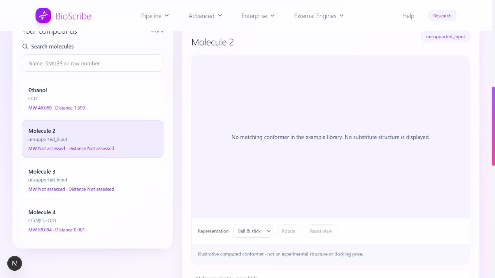

# HM-01 acceptance assessment — BioScribe

**Result: relevant working prototype; partial satisfaction of the statement.** The current application demonstrates descriptor calculation, conservative input rejection, explicit identity policies, saved evidence and repeatable execution on this host. It does not yet deliver precise error classification, a frozen PubChem/ChEMBL compound dataset, self-contained historical replay or demonstrated cross-machine equality.

Test date: 2026-10-23. Scope: HM-01, the fully readable “ProvenanceLab: Reproducible Molecule Analysis with Evidence Checks” statement in the supplied image. HM-02 is a different, partially visible prescription-safety problem and was not assessed.

No application code or scientific-study files were changed. New work consists of acceptance probes, fixtures, test results and this report. No external records or assay outcomes were fetched.

## Requirements extracted from the image

- Help biotechnology students analyze and compare molecules reproducibly.
- Precisely identify invalid inputs and missing evidence; do not silently fill absent values.
- Decide when alternative molecular representations are the same under an explicit policy.
- Replay past runs exactly and obtain identical results on every rerun, on any machine.
- Use frozen snapshots of PubChem and ChEMBL records instead of depending on live services.
- Build a test set containing broken and tricky inputs.
- Keep “not computed,” “not available” and “not applicable” distinct.

The identity requirement does not justify treating every salt, protonation state, tautomer or stereoisomer as interchangeable. The test accepts BioScribe's explicitly stated exact-graph policy; parent-compound grouping would require a separate policy.

## Executed checks

| Check | Result | Interpretation |
| --- | --- | --- |
| Existing backend suite | **173 passed**, one warning, 42.96 seconds | Established application invariants remain intact. |
| Existing frontend contract suite | **25 passed** | Evidence decoding and attribution checks pass. |
| Existing hackathon software checks | **23 passed** | Selection, example identity, export construction and learning fixtures pass. |
| New HM-01 consumer checks | **8 passed** | Mixed valid/invalid rows are retained, invalid values abstain and incomplete selection is blocked. |
| New HM-01 requirement probes | **25 pass, 7 unmet probes**; exit **2** | Open capabilities, not seven newly introduced regressions. Several probes concern the same requirement; this is not a percentage-complete score. |
| Repeatability | **3 independent processes, same exact artifact hash** | Socket connections denied in each child. Same Windows host, Python and locked dependencies; not cross-platform verification. |
| Browser mixed-input check | **Observed expected abstention** | Four rows retained; broken-ring and dummy inputs show `unsupported_input`/“Not assessed”; no substitute 3D model; shortlist export disabled. |

Machine-readable evidence: [results.json](results.json), [client-checks.json](client-checks.json), [backend-tests.xml](backend-tests.xml). [Browser evidence](mixed-input-browser.jpg) came from the earlier equivalent persisted fixture `7db878957e294c50af35574a66e66124`; rerunning the probe creates new isolated run IDs, so the current fixture ID can differ. Fixture inputs and expected observations are unchanged.

## Requirement matrix

| Requirement | Status | Observed evidence | Remaining acceptance condition |
| --- | --- | --- | --- |
| Calculate and compare molecular properties | Pass within current scope | Ethanol fixed fixture: MW 46.069 g/mol and TPSA 20.23 Ų. Supported rows have method/version/unit/evidence metadata. Existing shortlist checks pass. | Do not describe descriptor distance as biological activity, affinity or safety. This is a software fixture, not an independent property benchmark. |
| Reject malformed or unsupported inputs without inventing numbers | Pass for tested cases | All eight negative input classes abstained without numeric values. | Retain this behavior while improving error detail. |
| Classify invalid inputs precisely | **Unmet** | Eight distinct fixture classes produced **one** reported diagnosis signature. | Structured error codes, bounded source locations and actionable explanations must distinguish syntax, valence, unsupported graph/annotations, character-policy and resource-limit failures. |
| Preserve molecular identity and ambiguity | Partial | Nine identity-pair checks passed. Tetrahedral ambiguity is recorded as `?`; unspecified alkene geometry has no explicit ambiguity item. | Show the identity/normalization policy and unresolved stereo warnings to the user; cover double-bond ambiguity. Do not invent missing stereochemistry. |
| Never silently impute missing values | Pass within tested scope | Unsupported inputs and disabled predictions remain null/absent; invalid library members are not discarded to make a shortlist succeed. | Preserve all requested property records, including explicit failure/missingness records. |
| Distinct missing-value meanings | **Partial** | Execution unavailability and validation applicability exist, but unsupported molecular descriptors disappear from the output; the UI displays one “Not assessed” label. | Give each requested property a semantic missingness reason, preserve it through API/UI/export, and distinguish non-execution, unavailable evidence/model and an inapplicable/undefined quantity. Equivalent encoding is acceptable; exact enum spelling is not the requirement. |
| Frozen PubChem and ChEMBL compound records | **Unmet in the active workflow** | Example source is a local list of eight SMILES, with no record-bound compound snapshot from either source. | Freeze identified records from both sources, raw bytes, source release/version when available, retrieval metadata, hashes, units, mappings and curation decisions; demonstrate offline use. |
| Historical replay | **Partial** | Persisted result retrieval and source/registry/lock verification pass. Manual recomputation using the private stored request matches. | A supported replay operation and portable package must include exact original inputs, parameters, source snapshots, implementation/runtime identity and expected result digest; verify recomputation instead of only displaying an old result. |
| Same results on any machine | **Unverified** | Exact repeatability demonstrated on one host only. | Define supported platforms, build/runtime identity and comparison semantics, then run at least a second independent environment. Separate scientific result equality from necessarily new run IDs/timestamps. |
| Broken/tricky test corpus | Pass within current coverage | Existing sentinel fixtures plus eight rejection cases and nine identity pairs in this assessment. | Expand alongside the diagnostic and missingness contracts; retain fixture intent and expected outcomes. |

## Concrete counterexamples and paths

**1. Precise classification is missing.**

| Input | Fixture intent | Current result |
| --- | --- | --- |
| `C1CC` | Unclosed ring | `unsupported_input`, no numeric output |
| `C(C)(C)(C)(C)C` | Excess carbon valence | Same diagnosis |
| `CCO C1OC1` | Whitespace/multiple records | Same diagnosis |
| `*CC` | Unresolved dummy atom | Same diagnosis |
| `C~C` | Unsupported query bond | Same diagnosis |
| `CCО` (last character Cyrillic) | Non-ASCII input | Same diagnosis |
| 257-carbon chain | Atom bound exceeded | Same diagnosis |
| `CCO \|$C;C;O$\|` | Unsupported annotation | Same diagnosis |

The parser returns `None` for multiple causes, and `chemistry()` collapses them into one generic abstention. See [compute.py](/E:/Bioscribe/CascadeProjects/windsurf-project/backend/bioscribe/compute.py:60) and [unsupported-input branch](/E:/Bioscribe/CascadeProjects/windsurf-project/backend/bioscribe/compute.py:90). Preserve sanitized errors; do not re-enable raw RDKit stderr or tracebacks to obtain diagnostics.

**2. Identity policy is useful, but ambiguity communication is incomplete.**

`CCO` and `OCC` share canonical identity; aromatic/Kekulé benzene and reordered salt fragments also match. Opposite stereoisomers, unspecified versus specified stereochemistry, neutral versus charged forms, salts versus parents, keto/enol forms and isotope substitutions stay distinct. These distinctions follow the current policy and are not failures. Tetrahedral `NC(C)C(=O)O` records an unassigned center; `FC=CF` records no explicit double-bond ambiguity warning. See [identity construction](/E:/Bioscribe/CascadeProjects/windsurf-project/backend/bioscribe/compute.py:93).

**3. Safe abstention is not a complete missingness contract.**

For the invalid `C1CC`, the molecular-weight field is absent, rather than an explicit requested-property record explaining non-computation. Unavailable affinity has an `unavailable` execution state. For `[H][H]`, aromatic-heavy-atom fraction has no heavy-atom denominator and returns null with `unsupported_input`/`undetermined`; it is not explicitly represented as an undefined/inapplicable quantity. The explorer renders absent numeric fields as “Not assessed.” `validation_status=not_applicable` on a computed descriptor concerns predictive validation, not a missing property. See [Evidence schema](/E:/Bioscribe/CascadeProjects/windsurf-project/backend/bioscribe/schemas.py:96) and [display mapping](/E:/Bioscribe/CascadeProjects/windsurf-project/bioscribe-ai/src/components/Phase3Explorer.tsx:11).

**4. Retrieving an export is not historical recomputation.**

The store retains exact request JSON internally, and manual recomputation from it passes. The supported RunView export lacks that request. An input `OCC` is exported as canonical `CCO` plus the original input hash; the original spelling cannot be recovered from the hash. Unsupported inputs have even less reconstructable input content. The provenance bundle contains source code, methods and a dependency lock, but not the original request or an archived executable environment. The supported API has retrieval/export/provenance routes and no replay operation. See [stored request](/E:/Bioscribe/CascadeProjects/windsurf-project/backend/bioscribe/store.py:85), [export](/E:/Bioscribe/CascadeProjects/windsurf-project/backend/bioscribe/api.py:149), and [provenance bundle](/E:/Bioscribe/CascadeProjects/windsurf-project/backend/bioscribe/provenance.py:15). A CLI could satisfy replay too; none was found for general historical application runs. `learning/replay.py` is a separate synthetic exercise.

**5. Offline execution currently has no PubChem/ChEMBL record qualification.**

The engine successfully runs without network access. However, local calculations alone do not establish correspondence to external records. Study reference files contain PubChem AID1030 descriptions, not the active demo's compound snapshot, and do not satisfy this requirement. This assessment did not access that study's outcomes or change its blocked design status.

## Work that would close the HM-01 gaps

1. Add typed input diagnostics and visible stereo ambiguity warnings while preserving null output on unsupported graphs.
2. Make requested property coverage explicit and propagate missingness reasons unchanged through API, UI and exports.
3. Add a versioned replay package plus a recomputation command. Verify exact inputs, method/runtime identity and result digest; fail explicitly on missing or incompatible dependencies. Never silently upgrade a historical method.
4. Create a small frozen PubChem/ChEMBL **compound-record** reference dataset with source IDs and hashes for this educational workflow; no target-study assay outcomes are needed.
5. Test the replay package in a second supported environment and document whether equality is byte-for-byte scientific payload equality or an explicitly justified numeric comparison. Do not promise “any machine” based on a lockfile alone.

A suitable current pitch is: **“BioScribe is a reproducible molecular-analysis workbench that validates inputs, keeps missing evidence visible and preserves traceable calculation reports.”** Exact portable replay and precise diagnostics should remain stated work in progress until their acceptance checks pass. More 3D visuals or predictive modules would not close these particular gaps.

## Reproduction

From the repository root:

```powershell
& .\.phase3-venv\Scripts\python.exe hackathon/hm01/probe.py
$probeExit = $LASTEXITCODE   # Expected: 2 while acceptance gates remain unmet
```

From `backend`:

```powershell
& ..\.phase3-venv\Scripts\python.exe -m pytest tests_phase3 -q --junitxml=../hackathon/hm01/backend-tests.xml
```

From `bioscribe-ai`:

```powershell
node scripts/hm01-check.cjs
npm run test:hackathon
npm run test:contract
```

The probe runner uses isolated temporary job storage. It saves a four-molecule mixed report for browser import: ethanol, an unclosed ring, a dummy-atom input and unspecified alanine stereochemistry. Browser checks used **Open run JSON**, selected the invalid row, and inspected the blank model, absent numeric values and disabled shortlist export. This does not claim a fresh UI submission for that fixture or cross-platform validation.


